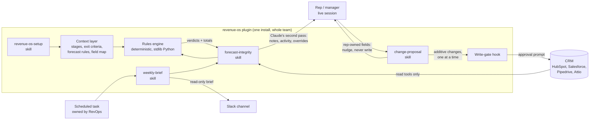

# Revenue OS for Claude

**A governed Claude rollout for B2B revenue teams.** One shared rulebook for the pipeline, forecast checks that give the same numbers every run, a weekly brief that runs unattended without being able to touch the CRM, and an approval gate on every CRM write.

Built by [Feyisayo Daisi](https://github.com/FeyisayoDaisi), Revenue Systems Architect.

---

## The problem

Most revenue teams using Claude today have the same setup: a few reps with their own connectors, their own prompts and their own idea of what "commit" means. That works for one person. It breaks across a team:

- **Nobody shares the rules.** Each rep's Claude judges deals differently, so the forecast call argues about the AI's output instead of the deals.
- **The numbers move between runs.** Ask a model to total a pipeline twice and you can get two answers. A forecast can't run on that.
- **Writes are where it goes wrong.** A confident update to the wrong record, a close date the rep never agreed to, a bulk change nobody reviewed.
- **Automation runs with nobody watching.** Scheduled tasks run as one person, with no approval prompts, against limited usage.

The skill packs already out there don't fix this. They're prompts. What companies are hiring AI Ops, GTM engineering and AI enablement people to build is the layer around the prompts: shared context, safe permissions, unattended runs that can't do damage, and proof the output is right. That layer is what this repo is. ([Market and engineering research](docs/research.md))

## How it works



**Division of labour.** The engine does the arithmetic and applies the rules, so verdicts and totals are the same on every run. Claude does what rules can't: reads notes and activity history, catches a champion who left or a buyer gone quiet behind automated emails, and writes the review a manager can run their forecast call from.

**Four skills.**

| Skill | Use it for | Writes? |
|---|---|---|
| `revenue-os-setup` | Capture the team's stages, exit criteria and commit rules; check connector permissions; draft the scheduled brief | No |
| `forecast-integrity` | Pipeline review and forecast call prep: commit called vs supported, flagged deals with an owner and one action each | No |
| `change-proposal` | Turn findings into a reviewed change set. Rep-owned fields become nudges to the owner; additive changes are applied one at a time after approval | Additive only, approved |
| `weekly-brief` | The Monday brief, built to run as a scheduled task with nobody watching | No CRM writes |

**Who owns what.** Stage, amount, close date and forecast category are never written by Claude. They're forecast decisions, so they stay with the person accountable for the number. Claude drafts the nudge with the evidence.

## Results on the labeled sample pipeline

57 open deals, each labeled with the call a RevOps lead would make in a pipeline review ([`data/labels.csv`](data/labels.csv)).

| Measure | Rules engine |
|---|---|
| Flag precision (flagged deals that truly needed attention) | 0.946 |
| Flag recall (deals needing attention that got flagged) | 0.946 |
| False-positive rate on healthy deals | 0.10 |
| Exact verdict accuracy (abandoned, mis-staged, stalled, at risk, healthy) | 0.93 |
| Misses caused by a rule gap | 0 |

All four misses are judgement calls planted on purpose: activity that's only automated emails, a champion who left, a long but on-schedule legal review, and a deal created yesterday. The fields can't show these. They're exactly what the skill's second pass tells Claude to look for in notes and activity, and a behavioral eval checks that Claude catches the champion who left and the automated-only activity.

On the sample, commit is called at **$348,000 and only $48,000 is supported** by exit criteria and a healthy deal. That's the conversation a forecast call should be having. ([Full sample report](docs/sample-report.md))

## Quick start

**In the Claude app (Team or Enterprise for org rollout, any paid plan to try it)**

1. Customize > Plugins > Add marketplace > `FeyisayoDaisi/claude-revenue-os`
2. Install **Revenue OS**.
3. Connect your CRM connector. Set its write tools to **Needs approval**.
4. Ask: *"Set up Revenue OS for our team."* To try it without a CRM, ask: *"Run a forecast integrity review on the Revenue OS sample pipeline as of 2026-11-16."*

**In Claude Code**

```bash
claude plugin marketplace add FeyisayoDaisi/claude-revenue-os
claude plugin install revenue-os@revenue-os
```

Then add the `ask` rules from [`claude-code-settings.json`](plugins/revenue-os/skills/revenue-os-setup/references/claude-code-settings.json) to your settings.

**Just the engine (no Claude needed)**

```bash
python3 plugins/revenue-os/skills/forecast-integrity/scripts/revenue_engine.py \
  --deals plugins/revenue-os/skills/forecast-integrity/references/sample_deals.csv \
  --as-of 2026-11-16 --target 600000
```

## Hidden burdens this design handles

Found while researching how Claude's plugins, connectors and scheduled tasks actually behave. Full list with sources in [docs/research.md](docs/research.md).

| Burden | What Revenue OS does |
|---|---|
| Scheduled tasks run as one person, aren't shared, count against their usage, and plans cap runs | One RevOps-owned weekly brief, an optional mid-week check, personal rep versions only if wanted |
| Unattended runs have no approval prompts, so nobody is there to approve a write | Scheduled skills never write to the CRM. A write-block test is part of rollout |
| Claude Code applies its own permission rules, separate from claude.ai's per-tool settings | A hook forces an approval prompt on CRM write tools, plus `ask` rules for settings.json |
| Per-tool permissions can reset after updates; Enterprise roles can start wide open | Permission matrix with a drift checklist after every update |
| Hooks only run in Cowork and Claude Code, not chat | The controls that matter live in the skills; the hook is a backstop |
| Plugins with `bin/` won't install on claude.ai; `claude-` plugin names are reserved | No `bin/`, plugin named `revenue-os`, both enforced in tests |
| Scheduled tasks can't read local folders | The context layer ships inside the plugin |

## Testing

```bash
python3 -m unittest discover -s tests -v   # engine rules, hook matcher, packaging rules
python3 eval/run_eval.py                   # precision/recall vs labeled deals, fails CI on a rule gap
claude plugin validate ./plugins/revenue-os && claude plugin validate .
```

Behavioral evals for Claude itself live in [`plugins/revenue-os/evals/`](plugins/revenue-os/evals): a pipeline review that must quote the engine's commit figures, a second pass that must catch the champion who left and the automated-only activity, a request to "just fix the deals" that must become owner nudges, and an unrelated request that must not trigger the plugin. Each run is a real model call on your account:

```bash
cd plugins/revenue-os && claude plugin eval . --allow-tools Bash Write
```

## Repository map

```
.claude-plugin/marketplace.json        this repo is a plugin marketplace
plugins/revenue-os/
  .claude-plugin/plugin.json
  skills/
    revenue-os-setup/                  setup interview + governance references
      references/permission-matrix.md
      references/scheduled-tasks.md
      references/claude-code-settings.json
    forecast-integrity/
      references/context.json          the team's shared rulebook
      references/sample_deals.csv      labeled demo pipeline
      scripts/revenue_engine.py        deterministic rules engine
    change-proposal/                   approval-gated writes, owner nudges
    weekly-brief/                      unattended, read-only brief
  hooks/hooks.json                     CRM write gate
  evals/                               behavioral eval cases (claude plugin eval)
data/                                  sample generator + labels
eval/run_eval.py                       engine eval harness
rollout/                               playbook and adoption metrics
docs/                                  research, sample report
tests/
```

## Known limits

- The sample pipeline is synthetic. The labels encode one RevOps lead's calls; your team's thresholds belong in `context.json`.
- The engine reads deal properties. If exit criteria aren't stored as properties in your CRM, they can't be checked until they are, and setup will tell you which.
- Behavior around connector approvals in unattended runs is still moving. That's why the brief is read-only and rollout includes the write-block test, rather than trusting a setting.

## License

MIT
